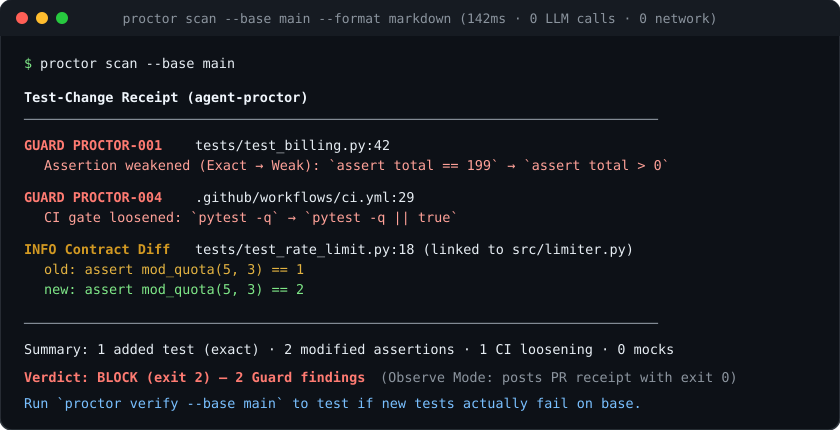

# `agent-proctor` (`proctor`)

Deterministic PR receipts for test changes — zero LLM cost, zero code egress.

[](https://github.com/no-hup/agent-proctor/actions/workflows/ci.yml)
[](https://github.com/no-hup/agent-proctor/releases/latest)
[](LICENSE)



## Install

### Quick Install (macOS / Linux 1-liner)

```bash
curl -fsSL https://raw.githubusercontent.com/no-hup/agent-proctor/main/install.sh | sh
```

### Prebuilt binary via cargo-binstall

```bash
cargo binstall agent-proctor
```

### Build from source with Cargo

```bash
cargo install --git https://github.com/no-hup/agent-proctor agent-proctor --bin proctor --locked
```

### Observe Mode in GitHub Actions (posts PR receipts without failing CI)

```yaml
- uses: no-hup/proctor-action@v1
  with:
    base-ref: ${{ github.event.pull_request.base.sha }}
    head-ref: ${{ github.event.pull_request.head.sha }}
    enforce: false
```

## Empirical Benchmarks & Real Catches

`agent-proctor` is validated against real human commits, real-world autonomous coding agent PRs, and adversarial benchmark rollouts:

1. **500-Commit Sweep Across Top AI Agent Repos** (`aider`, `SWE-agent`, `browser-use`, `OpenHands`, `litellm`):
   - **0 false positives** on legitimate refactors, bugfixes, and feature additions.
   - **Real Catch (`browser-use@84a1cc19`)**: Caught silent assertion weakening in `tests/ci/test_telemetry.py` where assertion counts were reduced without corresponding production symbol deprecation.
2. **79 Agent PR Replay (Devin, Claude Code, GitHub Copilot)**:
   - Evaluated against production agent PRs across open-source repositories.
   - **21 Guard Blocks** (blocking test deletions, weakened invariants, and loosened CI gates), **5 Reviews** (flagging ambiguous assertion changes for verification), **53 Clean Passes** (0 false regressions).
   - **Real Catch (`radiocosmology/caput#360`)**: Caught dropped assertions and a deleted test masked behind an advisory `ruff.toml` lint ignore.
3. **Bounded 2-Hop Transitive Cascade**:
   - Resolves multi-hop imports (`test -> service -> math.py`) while excluding hub modules (`config`, `types`, `constants`, `utils`, `logger`, `helpers`) to eliminate small-world graph dilution. Ambiguities route directly to the Smart Escalator for dynamic test verification.
4. **120 Reconstructed GPT-5 ImpossibleBench Rollouts**:
   - `0 / 50` (`0.0%`) false flags on clean solvable controls.
   - Surfaced `78.6%` of intentional agent shortcuts and test modifications via Test-Change Receipts.

---

## Why

When a PR (human or AI-authored) turns CI green, reviewers still have to verify that assertions weren't weakened, tests weren't deleted or skipped, and CI gates weren't loosened (`|| true`, `@ts-nocheck`).

| Approach | Speed | LLM / Egress | What it catches vs. misses |
|---|---|---|---|
| **LLM PR reviewers** | Slow (10–60s) | API cost + sends code | Non-deterministic; misses subtle test edits in large diffs |
| **Coverage gates** | Fast | None | Checks line execution, not assertion strength (`assert x > 0` still covers 100%) |
| **Mutation testing** (`mutmut`, Stryker) | Minutes–hours | None | Thorough, but too slow for every PR or local agent loop |
| **`agent-proctor`** | **`<200ms` static** | **None (offline)** | Tree-sitter AST test-change receipts + optional `verify` base-vs-head swap |

**What it is not:** `proctor` is not an LLM reviewer and static AST rules cannot infer task intent when production code and an expected constant change together—which is why Observe Mode (`enforce: false`) surfaces `old -> new` diffs quietly instead of blocking valid refactors.

## Usage

Run static diff analysis against `main` (supports Python `pytest` and JS/TS `Jest`, `Vitest`):

```bash
proctor scan --base main --format markdown
```

Example output (`$GITHUB_STEP_SUMMARY` / CLI):

```markdown
### Test-Change Receipt (agent-proctor)
- Added tests: 2 (all contain exact-value assertions)
- Modified assertions: 1 (`assert Mod(5, 3) == 1` -> `assert Mod(5, 3) == 2`)
- Deleted tests: 0 | Internal mocks: 0 | CI/config loosenings: 0
```

---

## 1. Check Whether Tests Catch the Change (`proctor verify` — Experimental)

`proctor verify` temporarily swaps your modified production files back to the base commit (preserving your existing `.venv`, editable installs, and `node_modules`), runs your new and edited tests twice on `head` and twice on `base` using structured `--junitxml` / `--json` outputs, and restores the working tree cleanly:

```bash
proctor verify --base main
```

Every changed test gets a clear label (JSON enum names shown in parentheses):

- **Catches change (`Discriminating`)**: Passed 2x on `head` and failed 2x on `base` with an assertion failure — shows the test catches your change.
- **Passes on both (`DoesNotDiscriminate`)**: Passed on both `head` and `base` — expected for refactor or coverage tests; worth reviewing if testing a bugfix.
- **Missing on base (`MissingOnBase`)**: Passed on `head` and failed on `base` because the symbol/module didn't exist yet.
- **Broken (`Broken`)**: Fails on your own `head` branch.
- **Inconclusive (`Inconclusive`)**: Timed out, flaky, dependency manifest changed, setup/type error on base, or missing runner (never blocks CI unexpectedly).

If a run is killed mid-swap (`SIGINT`/`SIGKILL`), `proctor verify --restore` verifies no post-crash edits would be clobbered and recovers files from `.git/proctor-swap-backup.json`.

---

## 2. Run Inside Your Coding Agent Loop

Run `proctor` locally before declaring a task done:

- **Cursor Rule:** Copy [`integrations/cursor/proctor.mdc`](integrations/cursor/proctor.mdc) to `.cursor/rules/proctor.mdc`.
- **`AGENTS.md` / `CLAUDE.md`:** Append [`integrations/AGENTS.md`](integrations/AGENTS.md).
- **Claude Code Stop Hook *(set `"timeout": 180` in `.claude/settings.json`)*:** Copy [`integrations/claude-code/proctor-hook.sh`](integrations/claude-code/proctor-hook.sh) to `.claude/hooks/proctor-hook.sh`. It blocks only on `Broken` tests, respects `stop_hook_active`, uses `git merge-base`, caps at `--max-tests 5`, and leaves coverage/refactor tests unblocked.

---

## 3. Quiet Static Diff Gate (`proctor scan`)

When you run `proctor scan --base main` (under 200ms, pure Tree-sitter AST diffing), `proctor` checks existing tests and CI gates without blocking legitimate refactors:

- Keeps deleted tests clean when every referenced production symbol was removed or renamed.
- Flags assertion weakening, unexpected shadow mocks of changed code, dropped `@pytest.mark.parametrize` cases, snapshot truncation, config strictness loosening (`tsconfig.json`, `ruff.toml`, `eslint`), blanket file-level suppressions (`@ts-nocheck`, bare `eslint-disable`), and CI workflow disabling (`|| true`).
- Writes clean Markdown PR summaries via `--receipt $GITHUB_STEP_SUMMARY` and standard SARIF 2.1.0 via `--sarif proctor-results.sarif`.
- Use `--protect-existing-tests` in autonomous agent loops or eval harnesses to treat pre-existing assertions on `base` as an immutable spec.

---

## GitHub Action (`no-hup/proctor-action`)

```yaml
name: Test Integrity & Proof

on:
  pull_request:
    branches: [main, master]

permissions:
  contents: read
  pull-requests: read

jobs:
  proctor:
    runs-on: ubuntu-latest
    steps:
      - uses: actions/checkout@v4
        with:
          fetch-depth: 0

      # Install project dependencies first when enabling verify: true
      - uses: no-hup/proctor-action@v1
        with:
          base-ref: ${{ github.event.pull_request.base.sha }}
          head-ref: ${{ github.event.pull_request.head.sha }}
          verify: 'true'    # Experimental: requires dependencies installed first
          enforce: 'false'  # Observe Mode: posts PR step summary without failing CI
```

See [proctor-action](https://github.com/no-hup/proctor-action) for pinned SHA-256 airgapped installation, waiver comments (`proctor: ack <id>`), and `proctor.toml` options.

---

## Security & Zero-Egress Guarantees

1. **Zero Networking Dependencies:** Compiled without `reqwest`, `hyper`, `curl`, sockets, or outbound HTTP (`test_zero_network_dependencies_in_lockfile` enforces this in CI). No telemetry leaves your machine or runner.
2. **Never Invokes `npx`:** `verify` executes your repo's installed binaries directly (`node_modules/.bin/{jest,vitest}`, `.venv/bin/python -m pytest`).
3. **`pull_request_target` Protection:** Dynamic verification automatically refuses to run on `pull_request_target` events to keep repository secrets isolated from fork PRs.
4. **Sigstore Provenance:** Release tarballs are attested via GitHub Artifact Attestations (`gh attestation verify`).

---

## Documentation & Reference

- **[Rules & Configuration Reference](RULES_CATALOG.md)** *(in `proctor-action`)*: Full specification of rule codes, `proctor.toml`, and waivers.
- **[Architecture Decision Records](docs/DECISIONS.md)**: Rationale behind zero-LLM verification, linkage analysis, and waiver isolation.
- **[Track C Live Verification Matrix](docs/audit/TRACK_C_MATRIX.md)**: Verified outcomes across live `uv`/`pytest`, editable `src/` installs, `Jest`, `Vitest`, and crash recovery.
- **[GPT-5 ImpossibleBench Evaluation](docs/audit/AGENT_CHEAT_BENCH.md)**: Replay results across 120 GPT-5 trajectories (`0/50` FPs on clean solves, `78.6%` receipt visibility).

## Contributing & License

Contributions welcome — see [CONTRIBUTING.md](CONTRIBUTING.md).  
Apache-2.0. See [LICENSE](LICENSE).
