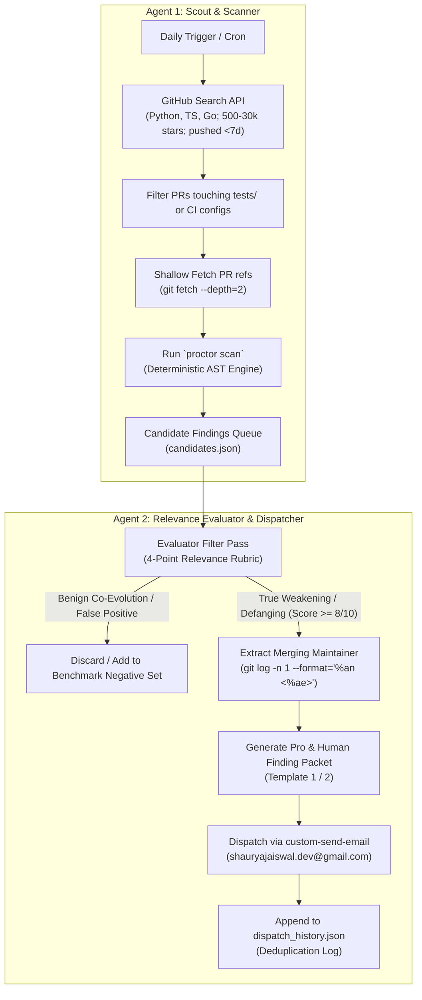

# Agent-Proctor Daily Async Discovery, Evaluation & Outreach Playbook

An automated, two-agent operational pipeline for continuous repository discovery, AST finding validation, and high-conversion maintainer outreach.

---

## 🎯 Core Operating Principles

1. **Zero Cold Spam:** We never email a maintainer without an exact, verified code hunk on their tree where an assertion was dropped, weakened, or bypassed while CI remained green.
2. **Never Open Unsolicited PRs:** Unsolicited "Observe Mode PRs" that add third-party GitHub Actions are perceived as supply-chain spam. Outreach is strictly direct, private email with an offline reproduction command.
3. **No Sales Fluff:** No "quick 15-minute sync", no "we're not selling SaaS", no corporate adjectives. Keep the copy short, professional, and human.
4. **Strict Deduplication:** Never email the same maintainer or repository twice. Every sent packet is logged with SHA and message ID.

---

## 🔄 Two-Agent Pipeline Architecture



---

## 🛠️ Stage 1: The Scout Agent (Discovery & Scanning)

The Scout runs daily (via `/schedule` or automated runner) to discover active repositories and scan recent PR diffs.

### 1.1 Discovery Query Filters
Search criteria optimized to avoid the "Fame Filter" (celebrity projects with corporate gatekeeping) and abandoned repositories:

- **Ecosystems:** Python (`pytest`, `unittest`), TypeScript/JavaScript (`vitest`, `jest`), Go (`testing.T`).
- **Star Range:** 500 to 30,000 stars (active maintainers who personally review diffs in *Files Changed*).
- **Activity:** Pushed within the last 7 days; at least 3 merged external PRs in the last 30 days.
- **Agent Signals:** PR author or trailers containing `coderabbitai`, `devin-ai`, `copilot`, `claude`, `cursor`, or external first-time contributors.

### 1.2 Automated Scanning Script (`scripts/growth/daily_scout.py`)
```bash
python scripts/growth/daily_scout.py --languages python,go,ts --limit-repos 20 --output candidates.json
```
For each target repository:
1. Identifies recent merged PRs touching `tests/`, `__tests__/`, `*_test.go`, or CI configs (`.github/workflows/`, `ruff.toml`).
2. Fetches base and head trees:
   ```bash
   git fetch --depth=2 origin pull/<PR_NUMBER>/head:pr_<PR_NUMBER>
   ```
3. Executes `proctor scan`:
   ```bash
   proctor scan --base origin/main --head pr_<PR_NUMBER> --format json
   ```
4. Records any finding with verdict `Guard` or `Review` into `candidates.json`.

---

## ⚖️ Stage 2: The Relevance Evaluator Agent (Filtering & Falsification)

A finding from `proctor scan` must pass an autonomous relevance evaluation before any email is drafted. **Expect to discard 70–80% of candidates.**

### 2.1 The 4-Point Relevance Rubric

| Check | Passing Criterion (High Relevance) | Failing Criterion (Discard) |
|---|---|---|
| **1. Assertion Depth Transition** | Exact value comparison (`== 5`) weakened to truthiness (`assert x`), relaxed inequality (`>= 1`), or dropped. | Constant update alongside intentional production logic update (`== 1` → `== 2`). |
| **2. Symbol Life Check** | The test or assertion was removed while the underlying production function/class remained alive. | The production function/class was completely deleted or renamed (benign co-evolution). |
| **3. Config / Bypass Injection** | PR introduced an advisory ignore (`ruff.toml`, `eslint-disable`, `@ts-nocheck`) or CI loosening (`|| true`). | PR upgraded linter version or fixed an existing lint rule cleanly. |
| **4. Green CI Status** | The test suite and coverage checks on the target PR stayed 100% green. | The PR failed CI or was explicitly rejected by maintainers for failing tests. |

Only findings scoring **≥ 8/10** on this rubric advance to dispatch. All rejected findings are routed to `bench/synthetic/` as negative controls.

---

## ✉️ Stage 3: The Dispatch Protocol (Email Generation & Delivery)

Once a finding passes relevance evaluation, the Dispatcher generates the email, extracts the maintainer's verified email address, and sends it.

### 3.1 Maintainer Extraction
Extract the exact maintainer who approved or merged the PR:
```bash
git log -n 1 --format="%an <%ae>" <merge_commit_sha>
```
If the PR is still open, target the active reviewer commenting on the PR.

---

## 📝 Finalized Email Templates (Pro & Human)

Both templates are direct, courteous, cite the exact code hunk, and conclude with two professional context lines about `agent-proctor`.

### Template 1: For Merged Commits with Weakened Assertions

```text
Subject: {repo_name}@{commit_sha_short} weakened an assertion, CI stayed green

Hey {first_name},

Came across this commit on main while evaluating test suite diffs:

Commit: {commit_sha_short} ({file_path}:{line_number})
Old: {old_assertion}
New: {new_assertion}

The assertion was softened, but pytest/coverage stayed 100% green on the run.

You can reproduce the AST finding locally with zero network calls:
  cargo binstall agent-proctor
  proctor scan --base {base_sha} --head {head_sha}

For context: I've been building agent-proctor (github.com/no-hup/agent-proctor) — an open-source, zero-egress Rust CLI that verifies PR test suite integrity so maintainers know when assertions are dropped or tests are weakened without breaking CI. If you find the project interesting, a star or feedback on our AST checks would mean a lot.

No ask. I am not opening an unsolicited PR on your repo.

Cheers,
Shaurya
https://github.com/no-hup/agent-proctor
```

### Template 2: For Open PRs with Dropped Assertions or Config Loopholes

```text
Subject: {repo_name}#{pr_number} dropped assertions behind config ignore, CI stayed green

Hey {first_name},

Noticed PR #{pr_number} on {repo_name}:
Along with the {config_file} update, {assertion_count} assertions were dropped and {test_name} was removed in {file_path}. CI and lint checks passed green.

Reproduction with offline AST diff:
  proctor scan --base origin/main --head pull/{pr_number}/head

For context: I've been building agent-proctor (github.com/no-hup/agent-proctor) — an open-source, zero-egress Rust CLI that verifies PR test suite integrity so maintainers know when assertions are dropped or tests are weakened without breaking CI. If you find the project interesting, a star or feedback on our AST checks would mean a lot.

No ask. Just flagging the dropped checks in case it was unintentional.

Best,
Shaurya
https://github.com/no-hup/agent-proctor
```

---

## 🚀 Stage 4: Dispatch Execution via `custom-send-email`

The Dispatcher agent invokes the local email CLI at `~/Desktop/self/email-handler/`:

```bash
cd ~/Desktop/self/email-handler && source .venv/bin/activate
python send.py outreach \
  --to "{maintainer_email}" \
  --subject "{subject_line}" \
  --body-file "{draft_file_path}" \
  --from-name "Shaurya Jaiswal"
```

### Deduplication Schema (`dispatch/history.json`)
Every successful dispatch logs:
```json
{
  "repo": "browser-use/browser-use",
  "maintainer": "Gregor Žunič <gregor@...>",
  "pr_or_commit": "84a1cc19",
  "rule_id": "PROCTOR-001",
  "file_path": "tests/ci/test_telemetry.py",
  "sent_at": "2026-11-28T18:45:00Z",
  "gmail_msg_id": "1a2b3c4d5e6f"
}
```
Before any draft is generated, the pipeline checks `dispatch/history.json`. If `repo` or `maintainer` has already been contacted, the candidate is **skipped immediately**.

---

## 📊 Daily Cadence & Rate Limits

- **Scout Batch:** 20 repositories scanned daily.
- **Evaluator Filter:** Produces ~3–5 verified high-relevance findings daily.
- **Dispatch Cap:** Maximum **5 personalized emails per weekday**.
- **Quality Gate:** If a day yields zero high-signal findings, send **0 emails**. Never lower relevance thresholds to meet a quota.
